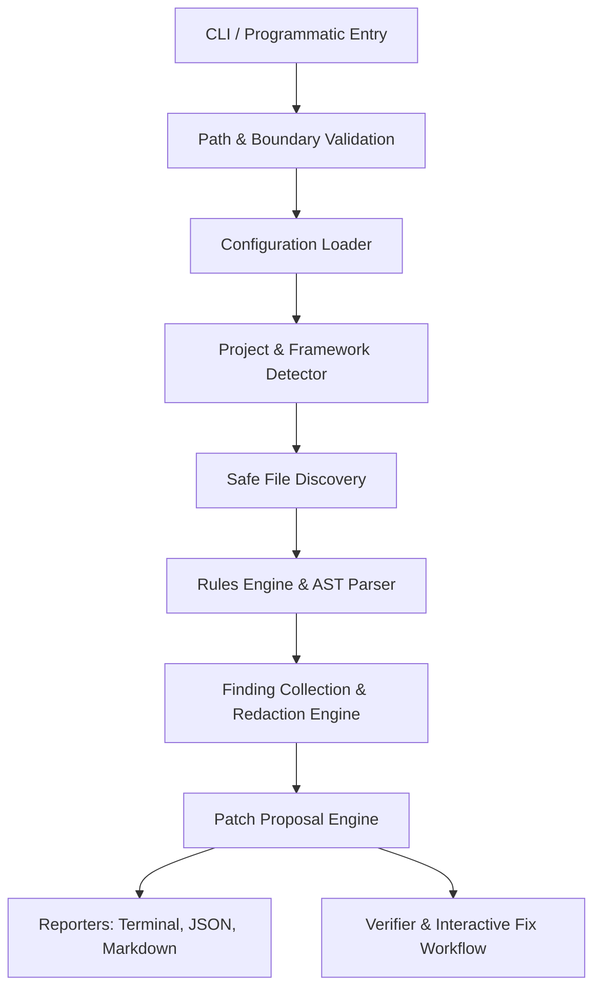

# ShieldKit Architecture & Subsystems

This document describes the architectural layout, data flow, safety invariants, and subsystem interactions of `@codewithraheem/shieldkit`.

---

## 1. High-Level Data Flow

---

## 2. Core Subsystems

### 2.1 Safety & Boundary Controls (`src/safety/`)
- **`path-validation.ts`**: Resolves canonical real paths using `fs.realpathSync`. Ensures that target files, included files, and written output paths never escape the project boundary.
- **`redaction.ts`**: Sanitizes tokens, API keys, passwords, private keys, and entropy spikes. Guaranteed invariant: *raw secret strings never enter Finding objects or report outputs*.
- **`sanitization.ts`**: Strips terminal escape codes (CSI, OSC) and control characters from untrusted strings to prevent terminal injection vulnerabilities.
- **`limits.ts`**: Implements resource bounds (1 MB default max file size, 5,000 max files, 25 directory recursion depth, and 60-second runtime ceilings).

### 2.2 Project & Framework Detector (`src/core/project-detector.ts`)
Inspects project manifests (`package.json`, lockfiles) and configuration files (`tsconfig.json`, `next.config.js`, `vite.config.ts`) to determine the active stack (Node.js, Express, React, Vite, Next.js, Mongoose). Avoids assuming framework membership solely from directory names.

### 2.3 AST & Static Analysis Engine (`src/analyzers/javascript/`)
- Uses `@babel/parser` with tolerant error recovery (`errorRecovery: true`).
- Parses modern ECMAScript, TypeScript, JSX, and TSX files.
- Provides a fast, recursive AST walker that delivers parent node references, callee types, and precise line/column locations to registered rules.

### 2.4 Typed Rules Engine (`src/core/rules-engine.ts`)
- Manages registration of security, quality, secret, and configuration rules.
- Enforces language and framework preconditions before running a check.
- Generates a deterministic, stable finding hash (`generateStableFindingId`) using `sha256(ruleId + ":" + relativePath + ":" + startLine + ":" + sanitizedEvidence)`.
- Enforces justified suppressions via `ignoreRules` configuration.

### 2.5 Safe Patch & Remediation Engine (`src/fixes/`)
- **`patch-builder.ts`**: Generates unified diffs via `createTwoFilesPatch` and records the SHA-256 hash of the original content.
- **`verifier.ts`**: Enforces race-condition protection. Compares the current on-disk hash against `originalContentHash`. If an external editor modified the file between scan and remediation, the patch is rejected.
- **`approval.ts`**: Requires explicit TTY prompt confirmation before file modification.
- **Atomic Writes**: Uses temporary files in the target directory and atomic renames to prevent file truncation or corruption.

### 2.6 Multi-Format Reporters (`src/reporters/`)
- **`terminal.ts`**: Formatted output with severity badges, location pointers, and summary counts. Supports `--no-color` / `NO_COLOR`.
- **`json.ts`**: Stable schema (version 1.0.0) containing tool, scan, project metadata, summary counts, and sanitized findings.
- **`markdown.ts`**: Formatted GitHub Flavored Markdown with executive summaries, findings breakdown, and remediation advice.
